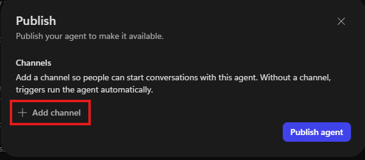
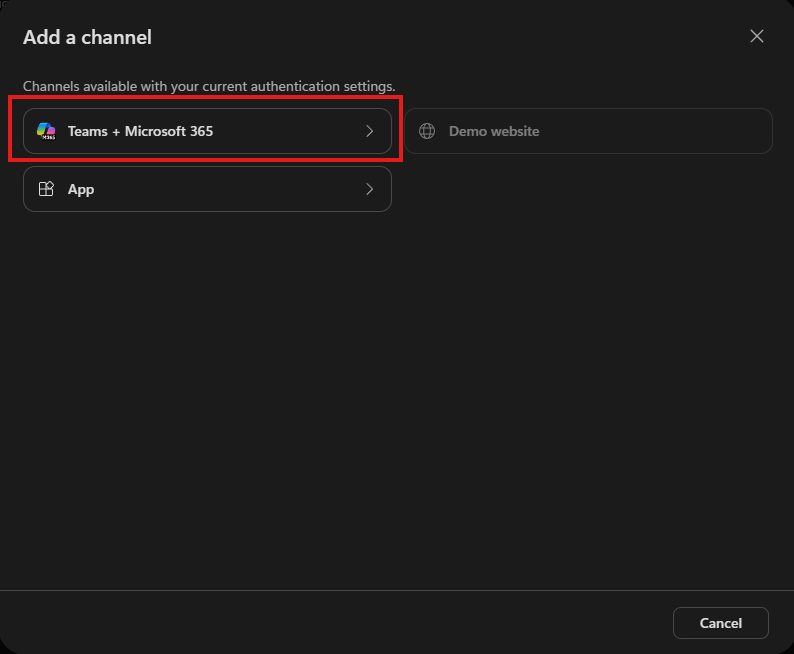
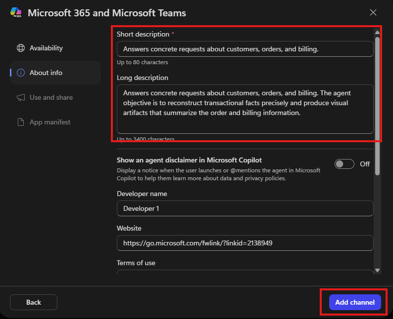
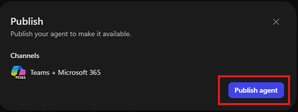
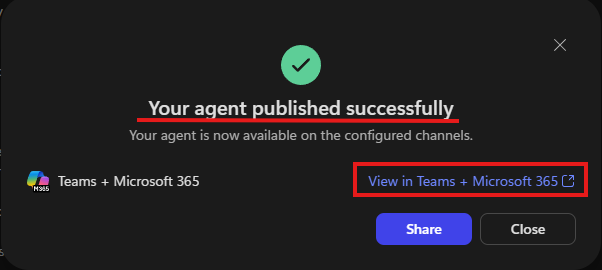
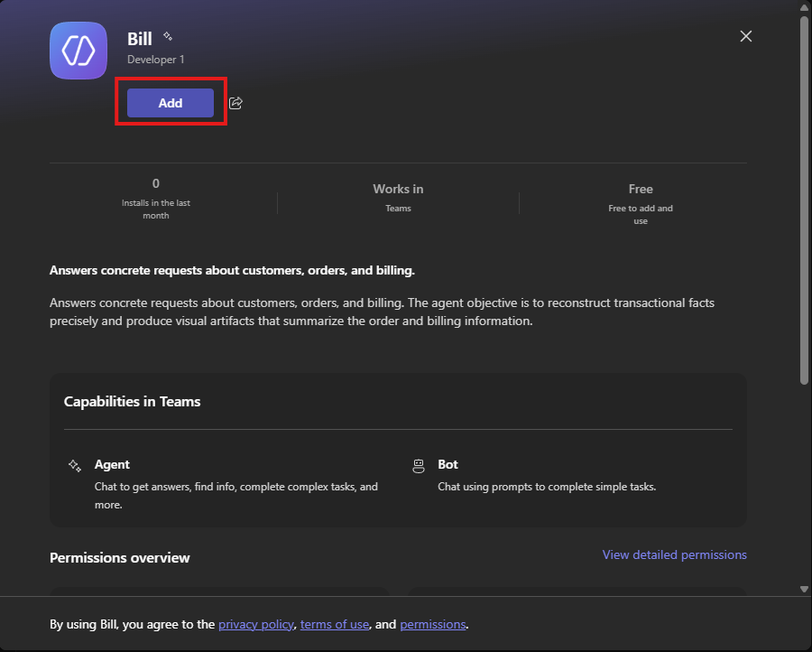
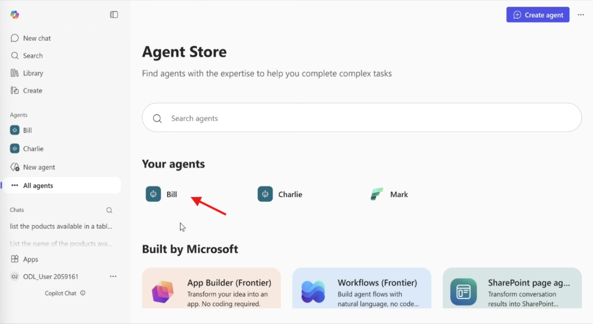

# MCS – Bill: Publishing and Testing

## 🎯 Mission summary

In this lab, we will publish the Bill agent and perform tests through the Microsoft 365 application.

## 🔎 Objectives

By completing this lab, you will learn:

- How to publish the agent using the Microsoft 365 and Microsoft Teams channel.
- How to query the agent from Microsoft 365.

---

## Publish the agent

1. Select the **Publish** button in the upper-right corner. A pop-up window will open, here we will first select the **+ Add channel**.

   

2. Select **Teams + Microsoft 365**

   

3. Here we will configure our Agent information before we publish.
4. Select the **About info** option and populate fields as follows (Anything not indicated leave as-is):

  - **Short description:** "Answers concrete requests about customers, orders, and billing."
  - **Long description:** "Answers concrete requests about customers, orders, and billing. The agent objective is to reconstruct transactional facts precisely and produce visual artifacts that summarize the order and billing information."

6. Press the **Add Channel** to commit chantes and continue to publish the Agent.
   
   

7. Now that the channel is configured, press the **Publish agent**

   

8. The window will close and you should see on the top right corner a Publishing status.

9. Once the Agent is published you should see a pop-up indicating that the Agent has been published. in this same window press the "**View in Teams + Microsoft 365**" link  

   

10. Now, in the Microsoft 365 app, you will see a pop-up window. Select **Add**.

   

11. Now our agent is ready to be tested!

---

## Test Bill

Let’s test Bill from the Microsoft 365 application.

1. Select Bill from your agents.

   

2. **Test prompt — Scenario 1:**

   ```text
   Generate a report with the purchase orders for customer CID-069, include order start and end dates, product, brand, category, quantity, price, customer name, and order numbers.
   ```

3. **Test prompt — Scenario 2:**

   ```text
   Show the product details for Coffee maker
   ```

   When the agent has responded, enter the following prompt:

   ```text
   Send me an email with that information
   ```

4. Now, in another tab, open <https://outlook.office.com> and in your inbox you will find the email with the information.

---

## 🎉 Mission completed

Great job! Our Bill agent is now complete.

✅ Congratulations! You have successfully published your agent, deployed it to a Microsoft 365 experience, and tested it before rolling it out to end users on the retail company site.
``
