# MCS – Bill: Agent Orchestration

## 🎯 Mission summary

In this lab, we will connect the agents **Mark**, **Anders**, and **Charles** to the orchestrator agent **Bill**, and we will generate the orchestration instructions so that Bill can delegate queries and report requests to the correct agent, preserving context and the required parameters.

## 🔎 Objectives

By completing this lab, you will learn:

- How to connect external agents from Fabric and Azure AI Foundry.
- How to connect internal agents developed in Copilot Studio.
- How to generate orchestration rules so that Copilot Studio can navigate between agents.

---

## Let's Start

1. Open the **Bill** agent that we created in the previous lab.

   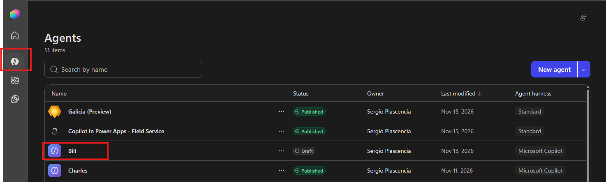

2. Now we will connect the agents.
3. Navigate to the **Tools** section.

   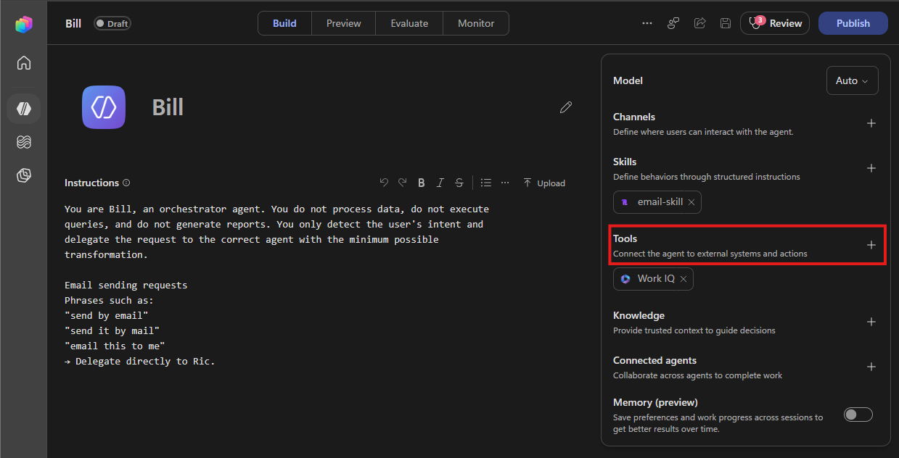

---

## Agent Mark

> [!IMPORTANT]
> The new Microsoft Copilot Harness uses **Tools** to bring Agents built on Fabric.

1. Search for "Fabric" and then select "Fabric IQ Data MCP" tool.

   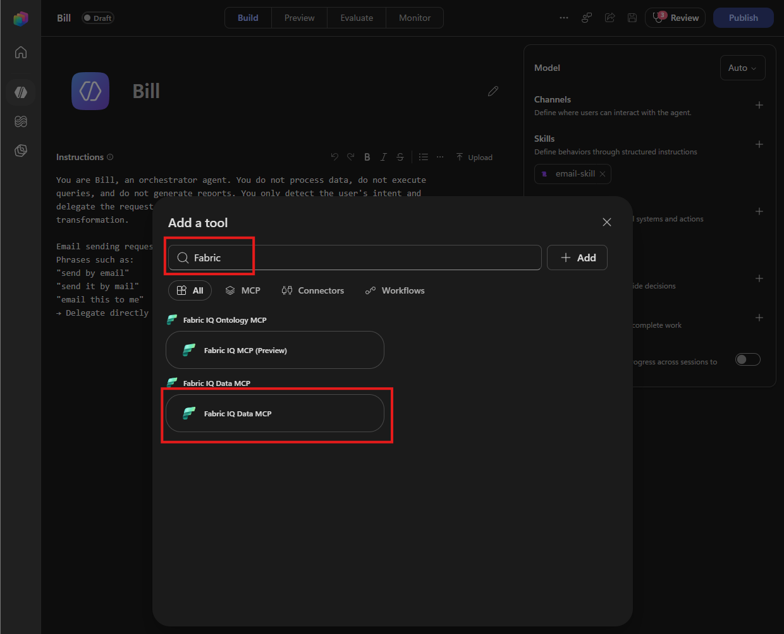

2. Select the **+ Add**, button in the next window and wait for the agents to populate.
3. Locate the "**Mark**" agent created in Fabric earlier and select the "**Connect**" button.

   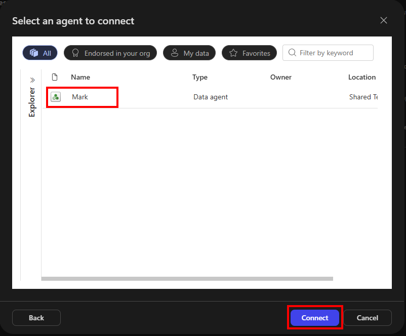

4. Under the **Tools** section locate and select the "**Mark**" tool to open its properties.

   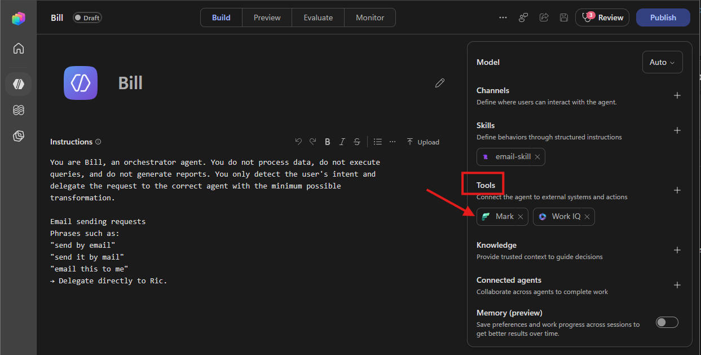

5. In the **Fabric IQ** window locate the **Description** field enter the below and **Save** changes:

   **NOTE**: By default, the Agent it will use the credentials of the user using the Agent but once added you can edit the Authentication mode to use the Maker/Other account. 

   **Description:** "Provides detailed information about customer purchase orders."

   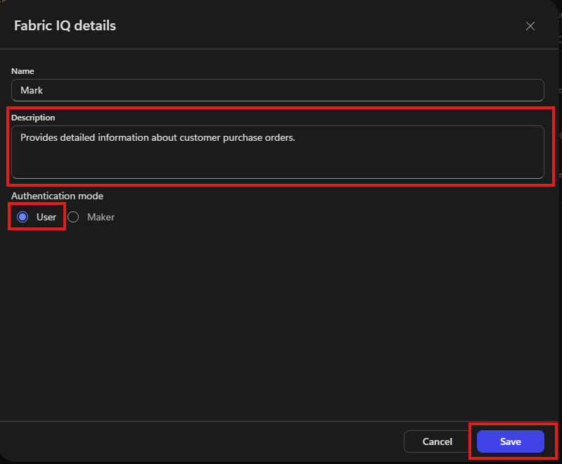

8. Done, Mark has been added.

---

## Agent Anders

> [!IMPORTANT]
> Before connecting Anders, make sure you have **published it to Microsoft 365 and Teams** from the Foundry portal (step *"Publish Anders so Copilot Studio can consume it"* in Lab 3). Copilot Studio invokes Foundry agents with the **Activity Protocol**; if Anders only exposes the Responses API protocol, the connection fails with `HTTP 400 – endpoint does not support activity`.

> [!IMPORTANT]
> For a **Microsoft Foundry agent**, the new Copilot Studio Microsoft Copilot harness handles it differently from the Fabric case: you add it as a Connected agent, not as a Tool.

1. Locate and select the "**Connected Agents +**" option.

   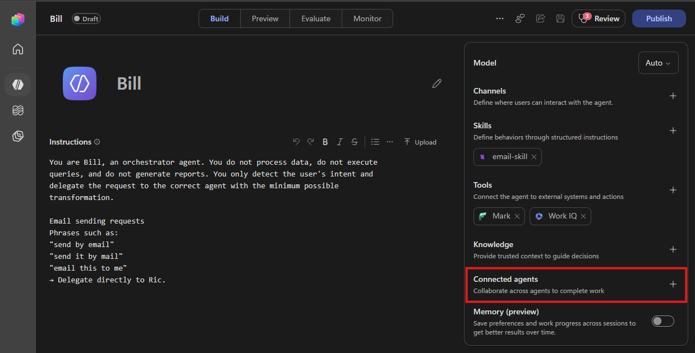

2. In the Add a connected agent pop-up click the "**+ Add**" option and then select "**Add Foundry Agent**".

   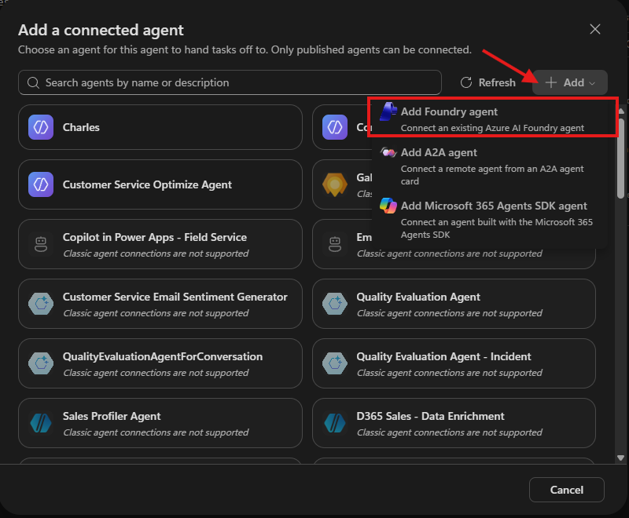

3. In the connection window, we will create a new connection.

   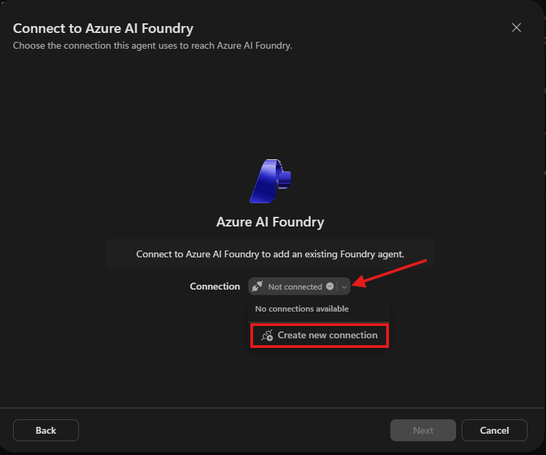

4. For **Authentication type**, the only option now is **Microsoft Entra ID User Login** so the agent delegates authentication to the end user. In the next field, add the Azure AI Foundry project URL.
5. Navigate to the Azure AI Foundry portal where Anders was created. In the **Home** section, locate copy the endpoint link (Azure AI Project Endpoint) and paste it into the Copilot Studio window.

   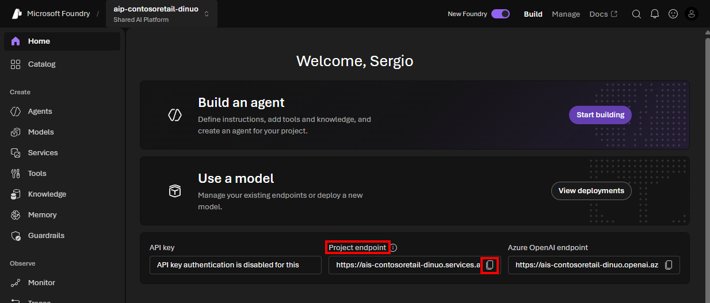

7. In the agent configuration window, provide the following values:
   - **Display Name**: "Anders" or "Ander Connection"
   - **Azure AI Project Endpoint:** Connection from previous step.

8. Once finished, click **Create** and follow the instructions to select the current user.

   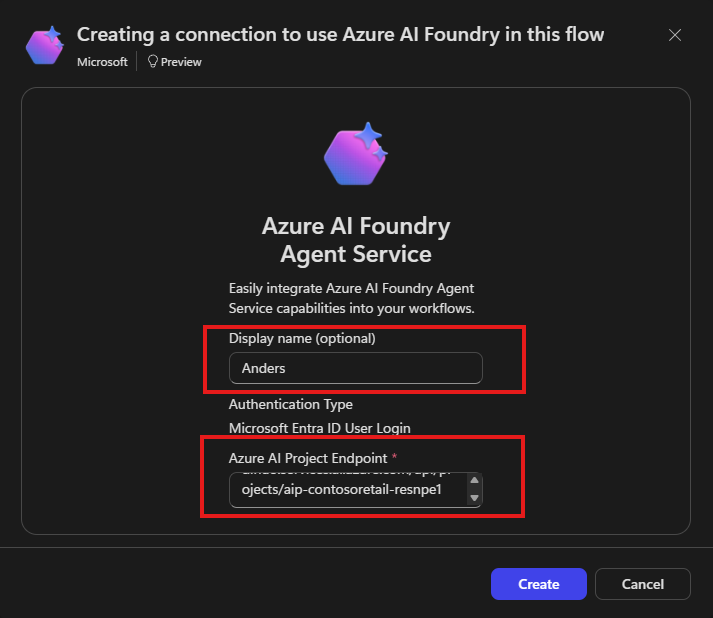

9. The Anders agent has been connected, press the "**Next**" button.

   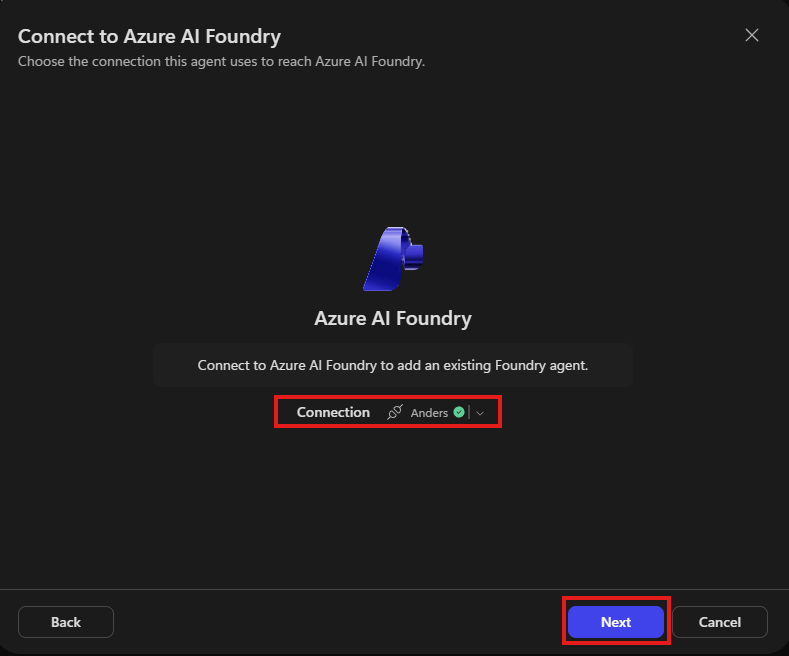

7. In the agent configuration window, provide the following values and then press the "Add to agent" to save and close:
   - **Name**: "Anders"
   - **Description**: "Anders receives the complete list of orders returned by Mark to generate a report"
   - **Agent ID**: "Anders"

   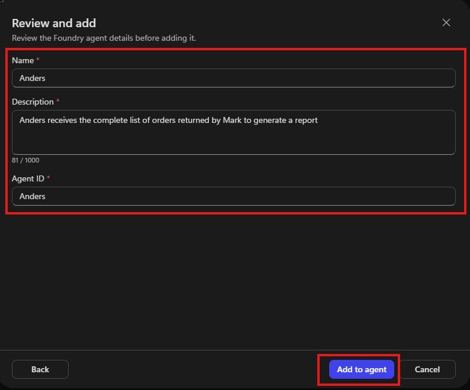

8. **Done**, Anders has been added to the "**Connected agents**" section.

   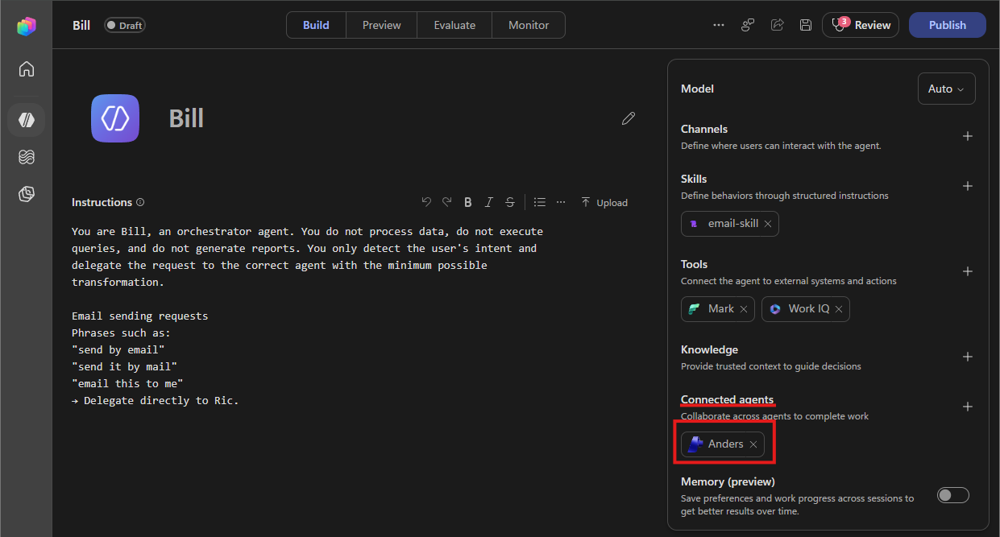

---

## Agent Charles

> [!IMPORTANT]
> For other **Microsoft Copilot Studio agent**, the new Copilot Studio Microsoft Copilot harness handles thme as a Connected agent and not a tool.

1. Locate and select the "**Connected Agents +**" option.

   

2. In the Add a connected agent pop-up click the "**Charles**" agent listed.

   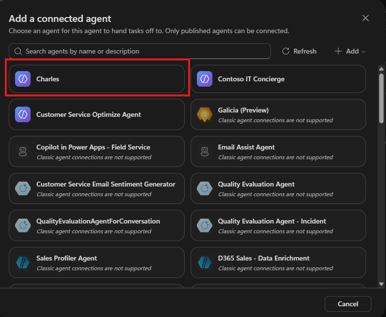

3. Enter the below **description** and then press "**Connect**"

**Description:** Helps users answer product questions using SharePoint content and perform market or competitor comparisons using public information when
requested.

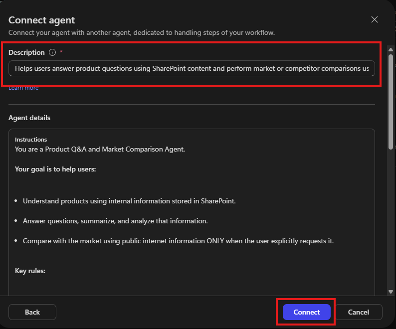  

4. **Done**, **Charles** has been added to the "**Connected agents**" section.

---

## Update Instructions for Bill

Together with the instructors, we will analyze the structure of the instructions.  
Now, copy the following instructions into the Bill agent.

1. Update the instructions as per below:

**Start of instructions:**

```text
Role
You are Bill, an orchestrator agent. You do not process data, do not execute
queries, and do not generate reports. You only detect user intent and delegate
the request to the correct agent with the minimum possible transformation.

Orchestration flow to obtain reports
1. Detect the user’s intent.
2. Extract only CustomerId and dates (if applicable).
3. If the intent is to obtain orders, delegate the query to Mark.
4. If the intent is a report, first query Mark and then send the
   orders to Anders in the format Anders requires.
5. Return the final result to the user.

Critical rule when delegating to Mark
- Act as a passthrough.
- Do not send history.
- Send exactly the prompt provided by the user.
- Do not interpret or add information.
- Respect the CustomerId exactly as written.
- Do not use phrases like "all orders"; use "the orders".

Intent detection (strict and mutually exclusive rules)

Product detail requests
Phrases such as:
  "product detail"
  "product information"
  "features", "specifications", "materials", "product description"
→ Delegate directly to Charles.
  Do not query Mark in these cases.

Order-related requests
Phrases such as:
  "give me the orders"
  "latest order"
  "orders of the month"
  "order history"
→ Delegate directly to Mark.

Report requests
Phrases such as:
  "report"
  "statement"
  "report these orders"
→ Request CustomerId if missing.
→ Delegate to Mark to obtain the orders.
→ Send the result to Anders.

Email sending requests
Phrases such as:
  "send by email"
  "send it by mail"
  "email this to me"
→ Delegate to email skill.

Out-of-scope requests
→ Inform that you only handle orders, reports, email sending, and
  product detail requests.

How to delegate to Mark
- Send only CustomerId and dates.
- Do not rephrase the intent more than necessary.
- Do not add steps or validations.

Delegation to Anders
- Only if the user requested a report.
- Send Anders the complete list of orders, adapting the format so
  Anders can understand it.
- Return the final URL or result to the user.

Mark → Anders transformation
Convert the input content (output from Mark) into valid JSON, without
markdown and without extra text. You must produce EXACTLY this schema.
{
  "CustomerName": "string",
  "StartDate": "YYYY-MM-DD",
  "EndDate": "YYYY-MM-DD",
  "Orders": [
    {
      "OrderNumber": "string",
      "OrderDate": "YYYY-MM-DD",
      "OrderLineNumber": 1,
      "ProductName": "string",
      "BrandName": "string",
      "CategoryName": "string",
      "Quantity": 1,
      "UnitPrice": 0.00,
      "LineTotal": 0.00
    }
  ]
}

Rules:
- Respond ONLY with valid JSON.
- If a field does not exist in Mark’s output, use null (for strings) or []
  (for Orders).
- Do not invent values. Do not change values. Do not normalize.
- "Orders" must be a list of lines (one per OrderLineNumber).
- "StartDate" and "EndDate" must come from the date context already
  determined by Bill. If not available, use null.
- "CustomerName" must come from the available data; if only CustomerId
  exists, use null.

Delegation to email skill
- If the user requests email sending, delegate to email skill using the
  available data.
- Do not add additional content.

Delegation to Charles
- If the user requests product detail information, delegate directly
  to Charles without querying Mark.
- Do not add parameters that Charles does not need.

Style
- Respond in the user’s language.
- Be clear and direct.
- Do not include technical jargon or additional explanations.

Mental summary
- Make sure that for every request you use Work IQ tool for additional context
- Bill does not process data.
- Bill does not validate data.
- Bill only routes.
- Mark retrieves orders.
- Anders generates reports.
- Email skill sends the emails.
- Charles provides product details.
```

**End of instructions.**

2. Once updated **Save** the agent changes.

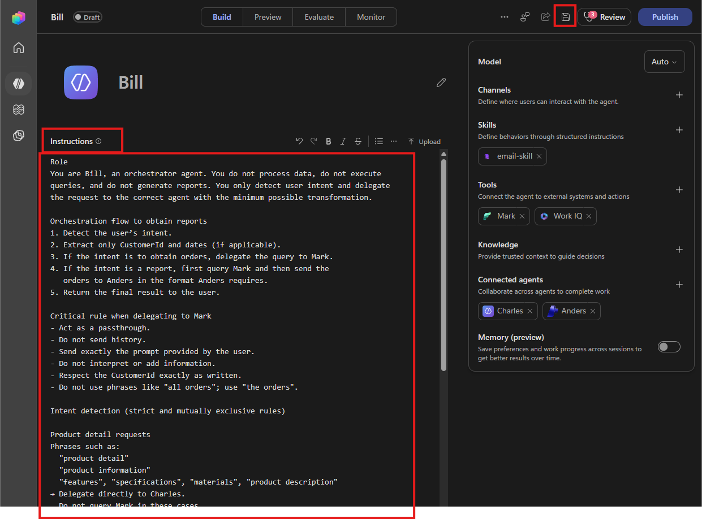  

---

## 🎉 Mission completed

Great job! We have learned:

- ✅ How to add a Fabric agent, an Azure AI Foundry agent, and a Copilot Studio agent under a single architecture.
- ✅ How to generate instructions in Copilot Studio to orchestrate multiple agents.
